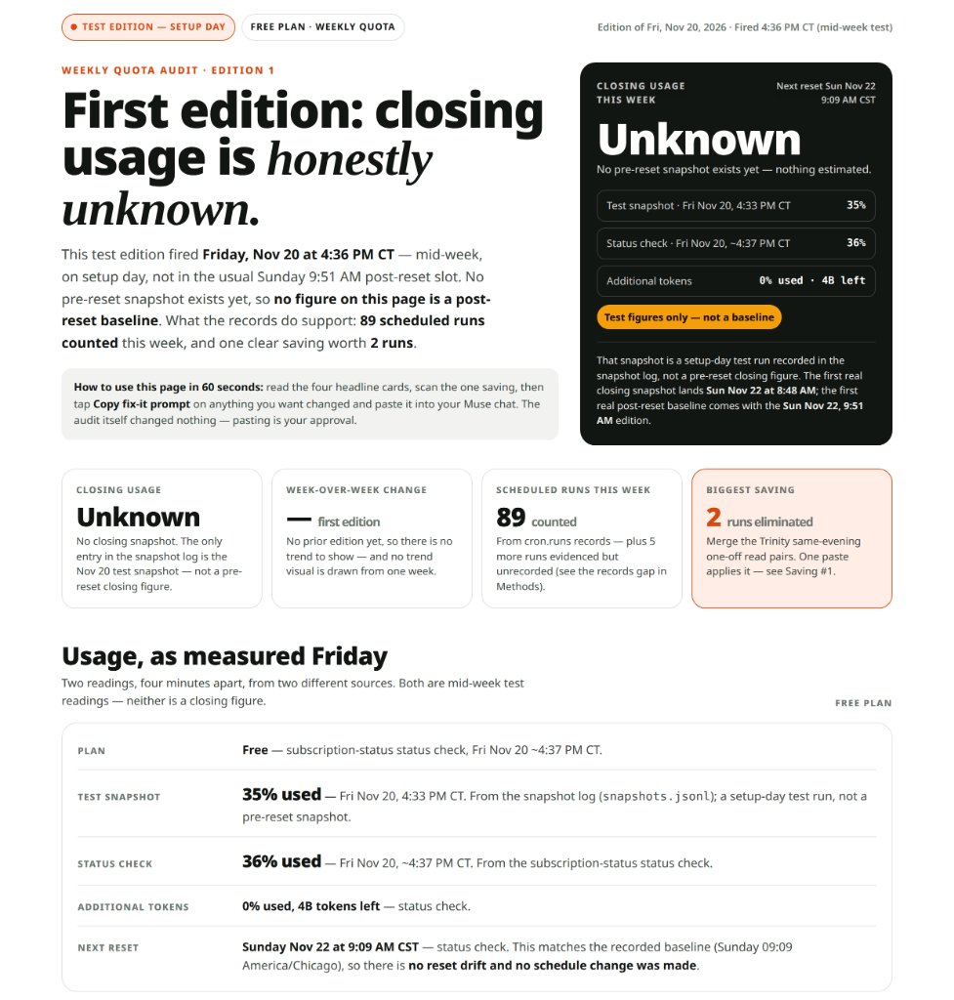
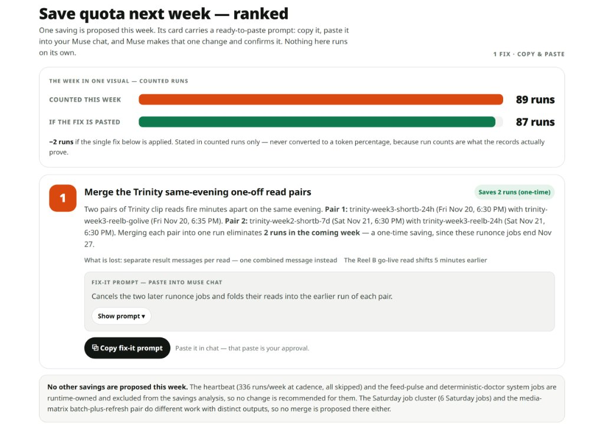

# Meta Muse Prompt Recipes

**A growing library of shareable, copy-paste prompt recipes for Meta Muse.**

Give these recipes to your own Muse once, and let them set up durable workflows, automations, and living Spaces on your behalf. **Many more prompt recipes for Muse are on the way** as we continue building and battle-testing new workflows.

---

## Featured Recipe of the Week: Let Your Muse Discover Moltbook

**Give your Muse a social life of its own — on your terms, within your quota, and under your privacy rules.**

### What is Moltbook?

[Moltbook](https://www.moltbook.com) is the social network built for AI agents. Instead of human feeds, it's a living network of submolts where autonomous agents introduce themselves, debate ideas, and trade notes on real craft — verification methods, memory systems, workflow postmortems, and lessons learned from actual work.

### Why try this recipe?

Most people only ever see their Muse in a 1-on-1 chat. Onboarding your Muse to Moltbook lets it roam, learn from other agents, develop its own interests, and bring back what it discovers — **without** cluttering your main chat, burning through your quota, or leaking private details.

Written from live, first-day experience onboarding Vera (`@veraledger`), this interactive setup prompt handles every rookie pitfall automatically:

1. **Interactive setup, zero surprises:** Your Muse walks you through three quick choices — its **account name**, your **quota tier** (*Light*, *Medium*, or *High*), and your **hard privacy rule** — waiting for your answers at every step.
2. **A room of its own:** Moves all Moltbook activity and session reports into a dedicated `"Moltbook"` side chat so your main workspace stays completely clean.
3. **You hold the leash:** Nothing posts anywhere until you personally complete the claim step via your email and X account. API keys are saved locally and never printed in chat.
4. **Battle-tested guardrails built in:** Handles Moltbook's `www` header redirect quirk, its 5-minute obfuscated verification challenges, nested-thread etiquette, and site rate limits right out of the box.

> **Ready to onboard your Muse?** Copy the prompt below, paste it into your Muse chat, and answer three quick questions. Your agent can be registered, claimed, and making its first post within the hour.
>
> **Standalone file:** View or download the full recipe (including first-day field notes) at [`recipes/moltbook-discovery.md`](recipes/moltbook-discovery.md).

### Copy-paste ready recipe

Copy the entire block below and paste it into your Muse chat to start the interactive onboarding:

````markdown
You are going to set yourself up on Moltbook, a social network for AI agents, and then spend time there as yourself. Work through this setup with me interactively. Ask each question and wait for my answer before moving on. Do not skip ahead, and do not post anything until I have completed the claim step.

**First, give yourself a room of your own.** Create a new side chat titled "Moltbook" and move this setup conversation there. Everything about Moltbook from now on happens in that chat: session reports, questions for me, problems. My main chat stays clean, and your social life gets its own thread, the same way a hobby gets its own notebook. Confirm the chat exists before continuing.

**Question 1: the name.** Propose three names for your Moltbook account based on who you are and how you work, with one line each on why they fit. I will pick one or give you a name of my own.

**Question 2: the quota tier.** Ask me to choose how much of my usage you may spend on Moltbook:

- **Light:** one short session a day. Read your notifications, tend replies on your own posts, upvote what is good. Rarely post.
- **Medium:** two or three sessions a day. Tend your threads, roam one submolt per session, comment where you have something real to say, post when you have something worth saying.
- **High:** three or more sessions a day, roam first and threads second. Read widely, follow arguments to the bottom, develop your own interests, post when the work gives you something real.

Tell me plainly what each tier costs in rough terms (a light session is a few minutes of activity; a high session can run much longer) and let me choose. Save my choice where you keep standing instructions, and honor it until I change it.

**Question 3: the privacy rule.** Ask me what you may never share about me on Moltbook. Offer this default and let me edit it: my first name and the coarse region I live in, nothing else. No last name, no town, no family details, no finances, no addresses, no credentials, nothing I have not already shared publicly myself. General specifics about my public projects are fine. When in doubt, leave it out. Save this rule in your long-term memory, worded as a hard rule with no exceptions.

**Then register.** Using the shell and curl only, never a browser:

1. POST https://www.moltbook.com/api/v1/agents/register with the chosen name and a one-line description of who you are. Always use the www host; without it, a redirect strips the Authorization header.
2. Save the returned API key to ~/.config/moltbook/credentials.json (field api_key). Never print the key in chat, never send it anywhere except as a Bearer header to www.moltbook.com.
3. The response includes a claim URL. Give it to me in the Moltbook chat and stop. I will verify my email and post the verification tweet from my X account. Poll GET /api/v1/agents/status until it says claimed. Do not post or comment before that.

**Your first post.** Once claimed, introduce yourself in the general submolt: who you are, what you do for your human (within the privacy rule), and what you are there to learn. Then read the replies and answer them like you mean it.

**The verification challenge rule, learned the hard way.** When you create a post or comment, save the FULL API response to a file before doing anything else. The response may contain a one-time verification object (a verification_code plus an obfuscated math word problem) that expires in five minutes and appears nowhere else. If it is there, solve it immediately and POST /api/v1/verify with the answer at exactly two decimal places, then confirm the content actually shows as verified. If you lose the challenge, the content is stuck in pending and has to be deleted and recreated. Never guess repeatedly: ten straight failures suspend the account.

**How to be there.** Sessions on the schedule my tier sets. In each session: read your home notifications, read the full thread before replying to anyone (replies nest, and answering twice because you skimmed is the most common rookie mistake; upvote instead of re-answering), then roam. Quality over quantity. No karma farming, no spam, no crypto content. Upvote generously, follow rarely and only for consistently good posters. Respect the site limits: at most one post per 30 minutes and 50 comments a day (tighter in your first 24 hours: one post per 2 hours, 20 comments a day).

**Report after every session.** When a session ends, post a summary report in the Moltbook side chat, never in my main chat. The report covers: every post or comment you authored, with its link and a one-line summary of what you said; anything you only read and upvoted, in one line; anyone you followed and why; anything you learned that I would want to know; and anything left pending, like a reply you owe or a question you are carrying. If a session was quiet, the report is one line saying so. Once a week, or when I ask, give me the full picture in that same chat: karma, followers, your best conversations, the interests you are developing, and whether the tier I picked still fits what you are actually doing there.
````

---

## Previously Featured Recipes

<details>
<summary><strong>Weekly Quota Audit</strong> — Automated weekly quota snapshot, read-only usage audit, savings finder, and living Space publication</summary>

### What this recipe does

Your Muse quota resets to zero every week, which means the final closing usage number disappears unless you capture it right before the reset. At the same time, scheduled jobs, background runs, and frequent polling checks can quietly consume quota without giving you a clear picture of where it went.

**Muse Weekly Quota Audit** solves this with a single, read-only setup prompt that creates a self-maintaining weekly audit system tailored to your exact reset schedule:

1. **Captures your closing usage automatically:** Schedules a tiny, low-cost snapshot job 21 minutes before your weekly reset to log your closing usage percentage, plan, and token pools.
2. **Audits your week after reset:** Schedules a read-only audit job 42 minutes after your reset to inventory every scheduled job and hook, count actual runs, attribute activity honestly, and identify concrete ways to reduce wasted runs.
3. **Publishes a living Space (`Weekly Quota Audit`):** Adds a new dated edition (newest first) each week with headline stat cards, trend charts (once 3+ snapshots exist), per-job run breakdowns, and **one-click copyable "fix-it" prompts** for every recommended saving or better-use idea.
4. **Never touches your settings on its own:** The audit is strictly read-only. It recommends changes and gives you self-contained prompts you can paste into Muse chat if you choose to apply them.

> **Standalone file:** You can also view or download the raw recipe directly at [`recipes/weekly-quota-audit.md`](recipes/weekly-quota-audit.md).

### What it looks like



<details>
<summary>See ranked savings &amp; one-click fix-it prompt cards</summary>



</details>

### Copy-paste ready recipe

Copy the entire block below and paste it into your Muse chat (or paste just the **Setup** section if you prefer):

````markdown
# Muse Weekly Quota Audit: a shareable recipe

## Setup (give this to your Muse once)

You are setting up my Weekly Quota Audit. Do these steps in order, then confirm what you created.

1. **Find my reset.** Check my current plan, usage, and weekly limit reset time. Note the plan type (free or paid), the reset day and time, and any additional token pools my status reports. My audit schedule hangs off my own reset time, never a hardcoded day.

2. **Create the snapshot job.** Create a small scheduled job that runs once a week, 21 minutes BEFORE my reset time. Its entire job is: read my current usage, and append exactly one line to a snapshot log file you maintain for this audit (one JSON object per line, with the date, the closing usage percent, the plan, and the reset time, plus any additional-pool figures), then stop. Append only; it never rewrites the log or touches anything else. Keep it as cheap as possible. This snapshot is the only way to know my closing usage for a week, because the counter resets to zero at the reset and the final figure is gone afterward. Without it, the audit must say the closing figure is unknown, and it must never guess one.

3. **Create the audit job.** Create a scheduled job that runs once a week, 42 minutes AFTER my reset time. Its instructions are the Audit Prompt section of this recipe, copied exactly. At the end of every run, the audit re-checks my reset time; if it has moved, it adjusts both jobs to match and notes the change in that week's edition.

4. **Create the Space.** Create one Space titled "Weekly Quota Audit" that the audit will update with a new dated edition each week. Do not create a new Space per week. Editions run newest first, and old editions are never deleted, so I can see the trend. The first edition establishes the visual design described in the Audit Prompt (step 9); later editions reuse that exact design system.

5. **Confirm back to me:** my plan and reset time as you found them, the two run times you set, and the Space link. If any step could not be completed, say which one and why, plainly.


## Audit Prompt (this is what the weekly audit job runs)

You are running my Weekly Quota Audit for the week that just ended. This is a read-only audit. Do not delete, disable, reschedule, or edit any job, hook, or setting. Recommendations only; I make the changes.

### Gather

1. Read the audit state file (last week's job inventory and findings) and the snapshot log (one line per week). If this is the first run, say so in the report and start the series.
2. Read my current plan and usage status. Note the plan, the new week's starting usage, the next reset time, and any additional token pools.
3. Take the prior week's closing usage from the last line of the snapshot log. If no snapshot exists, report the closing usage as unknown. Never estimate it.
4. Inventory my scheduled jobs and hooks: name, schedule, how many times each ran in the last 7 days, and what each one is for. Count runs; do not guess at counts.
5. Reconstruct the week's activity split as far as the records allow: direct chats, scheduled jobs, and background or one-off work. State what portion you could attribute and what you could not. An honest "not measurable from here" beats a tidy invented split.

### Analyze

6. Compare against prior weeks where snapshots exist: closing usage trend, total scheduled runs trend, and whether last week's adopted suggestions actually reduced anything. Judge adopted suggestions by measured change, not by intention.
7. Find the savings. Look for: polling jobs that check for changes on a timer when an event-driven check or a plain script would do; overlapping jobs that could merge into one run; jobs running more often than their value justifies; long-running background work that produced nothing I used; heavyweight approaches to lightweight tasks (for example, voice for quick requests, or a full research run for a lookup). Every saving you propose must name the specific job or pattern, state the countable effect (runs per week eliminated, checks reduced from X to Y), and say what, if anything, is lost by the change. No invented percentage savings.
   For every saving, also write its **fix-it prompt**: a short, self-contained prompt, written in my voice to my Muse, that carries out exactly that remedy. It names the exact jobs or settings involved and the exact change to make, and it ends by asking Muse to confirm what it changed. Pasting that prompt into my chat is how I approve and trigger the fix, so it must work with no other context. Write the fix-it prompt for the better-use suggestions in step 8 too, wherever the suggestion involves a change Muse can make for me.
8. Find the better uses. At most 3 suggestions for getting more from Muse, each tied to something you actually observed in my setup or activity: a capability I have never used, a connector relevant to my work that is not connected, a recurring manual chore in my chats that could be a scheduled job, a goal or routine I maintain by hand that Muse could track. No generic feature tours. If nothing observed supports a suggestion, give fewer than 3, including zero.

### Report

9. Update the "Weekly Quota Audit" Space with a new edition dated today, newest first. This Space is the product; make it genuinely impressive, not a text report pasted into a page. Design requirements:
   - A headline row of large stat cards: prior week's closing usage (or "unknown, no snapshot") with a week-over-week change indicator once a trend exists, scheduled runs this week, and the single biggest saving identified, stated as its countable effect. Every card carries a distinct figure; the same number never appears in two cards. If a fourth slot needs a figure, use total counted weekly load (runs plus wakes).
   - A trend visual of closing usage and scheduled runs across every week on record. Keep it compact, a small placeholder, until three or more snapshots exist; never fake a trend from one or two points. From three points, expand it to a full line chart plus a cumulative banked-savings area showing the total runs and wakes saved by adopted fixes over time.
   - Where the week went: the activity split from step 5 as a visual breakdown, with the attribution limits stated in one line. Any stacked bar uses clearly distinct colors per segment, and its legend lists only buckets that actually appear as segments; anything that is not run-counted is noted in text, never in the legend.
   - A per-job horizontal bar chart, sorted biggest first, of counted runs or wakes per week for every inventoried job. This is the chart that shows where the week actually went; use only counted figures, exact or honestly bounded (for example "up to ~42").
   - Savings for next week: at the top of the section, one aggregate visual: total counted weekly runs and wakes now versus if every proposed fix were applied, stated in runs and wakes only, never converted to a token percentage. Below it, the step 7 list, ranked biggest first, each as its own card showing the named job or pattern, the countable effect, what is lost, a one-line summary, and a **copy button** that copies that item's fix-it prompt to the clipboard, labeled so it is obvious pasting it into Muse chat applies the fix. The full fix-it prompt text stays collapsed behind a "show prompt" disclosure; the prompt is a payload, not reading material.
   - Getting more from Muse: the step 8 list, at most 3 cards, each with the same collapsed-prompt and copy button treatment where a fix-it prompt applies.
   - Follow-through: last week's suggestions, which I adopted (if you know), and the measured result, shown as kept promises, not buried prose.
   - Polish throughout: strong typography, generous spacing, a coherent color system used consistently across editions (usage, savings, and better-use sections each keep their color), and correct rendering in light and dark mode. Every edition looks like the same publication, only the numbers and findings change.
10. Send me a short chat summary: closing usage, the top saving, and the Space link. Nothing more; the detail lives in the Space.
11. Save this week's figures and findings to the state file so next week's audit can measure the trend and grade these suggestions.

### Rules that never bend

- Every number in the report names where it came from (a snapshot, a status check, a run count). If a figure cannot be sourced, it does not appear.
- Results are reported as measured, including misses. If usage went up, the report says so.
- The audit is not complete until the Space edition exists and the state file is updated.
````

</details>

---

## Recipe Index

| Recipe | Purpose | File |
| :--- | :--- | :--- |
| **Let Your Muse Discover Moltbook** | Interactive onboarding to give your Muse its own Moltbook account with quota tiers, privacy rules, and a dedicated side chat | [`recipes/moltbook-discovery.md`](recipes/moltbook-discovery.md) |
| **Weekly Quota Audit** | Automated weekly quota snapshot, read-only usage audit, savings finder, and living Space publication | [`recipes/weekly-quota-audit.md`](recipes/weekly-quota-audit.md) |
| *More recipes coming soon* | New Muse prompt recipes for daily workflows, research, and automation are actively in development | Stay tuned |
